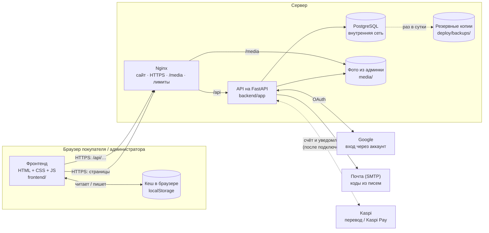
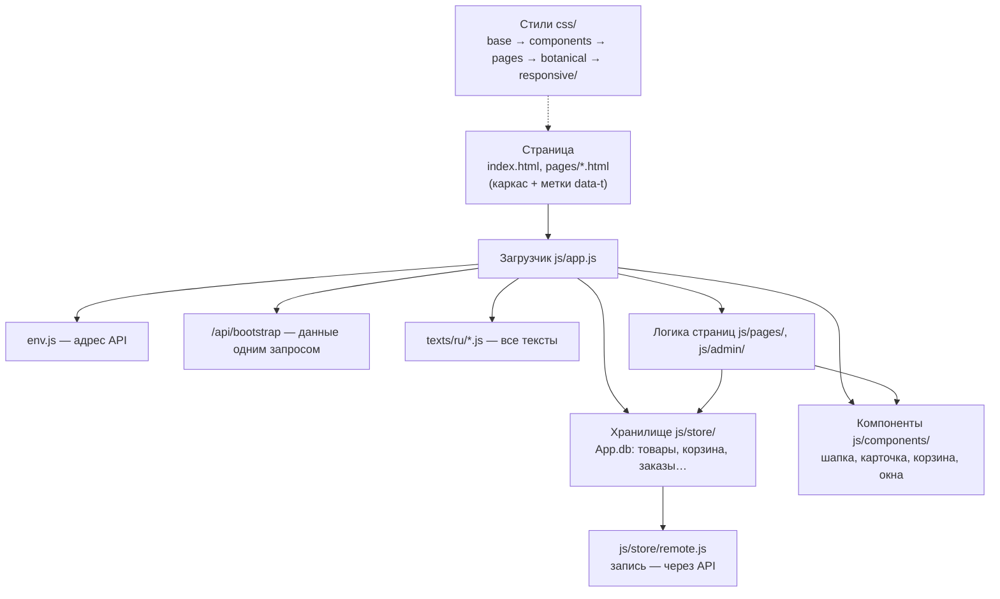
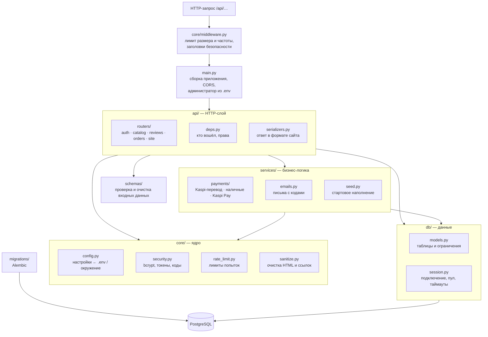
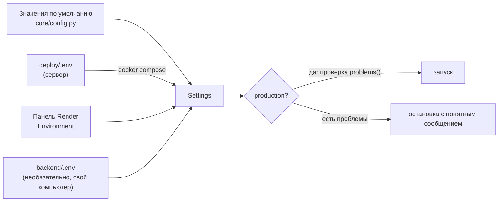
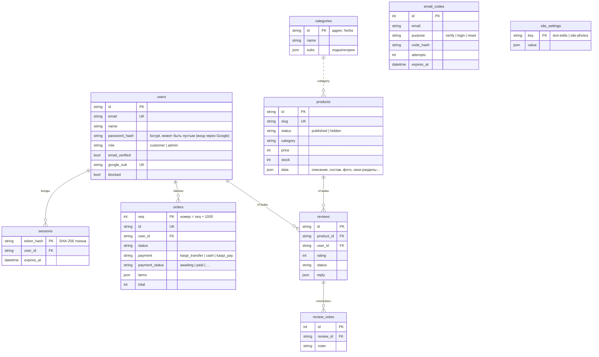
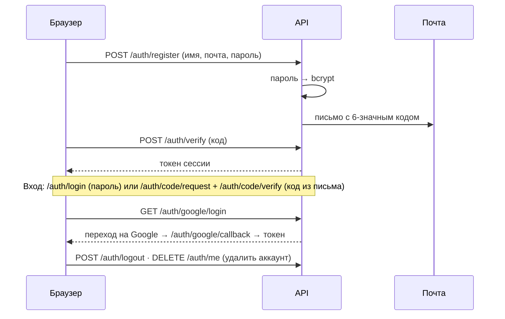
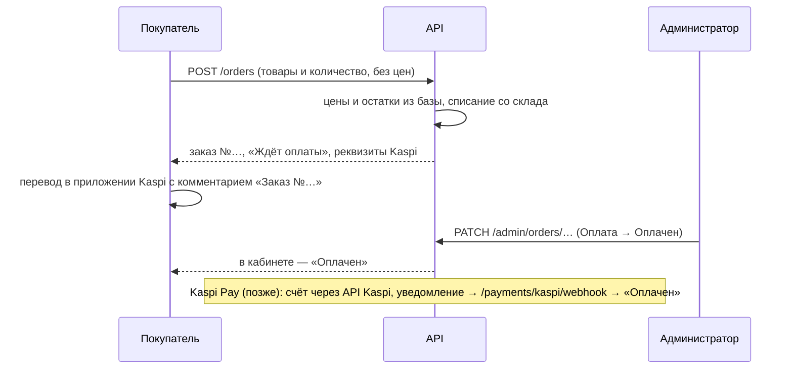
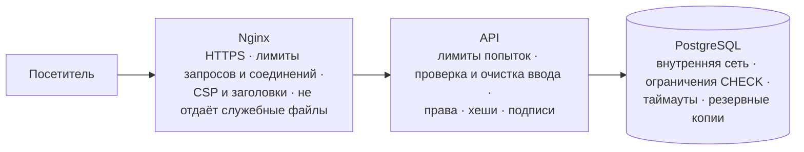
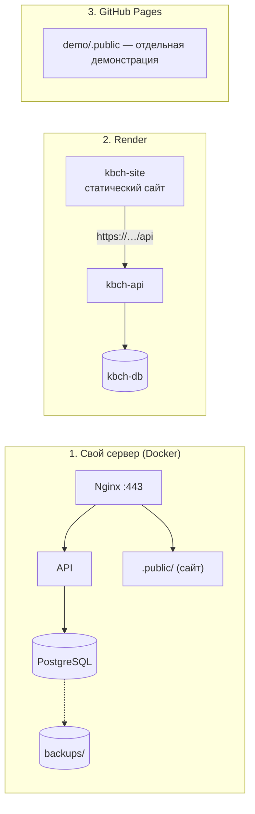

# 12. Архитектура сайта

Как устроен магазин целиком: из каких частей он состоит, как они общаются и где хранятся данные.
Схемы ниже GitHub показывает картинками (формат Mermaid).

## Общая схема



| Часть | Что делает | Где лежит |
|---|---|---|
| **Фронтенд** | Всё, что видит человек: страницы, корзина, кабинет, админка. Без сборки — обычные файлы | `frontend/` |
| **API (бэкенд)** | Аккаунты, каталог, заказы, отзывы, оплата, тексты сайта. Проверяет права и считает суммы | `backend/app/` |
| **PostgreSQL** | База данных: всё, что должно быть общим для всех посетителей | Docker / Render |
| **Nginx** | Отдаёт файлы сайта, направляет `/api` в API, раздаёт фото, включает HTTPS | `deploy/nginx/` |
| **Почта (SMTP)** | Письма с кодами: подтверждение почты, вход по коду, сброс пароля | Gmail или другой ящик |
| **Google** | Вход через Google-аккаунт | console.cloud.google.com |
| **Kaspi** | Оплата: сейчас перевод на номер владельца, позже Kaspi Pay | `backend/app/services/payments/` |

Сайт может работать **без сервера** (демо): тогда вместо API данные лежат только в кеше браузера. Переключатель — `frontend/env.js` (см. [раздел 11](11-Бэкенд-и-деплой.md)).

---

## Фронтенд: слои



- **Каркас** — HTML без текста: тексты подставляются из `texts/ru/` (можно править в админке).
- **Хранилище** `App.db` — единственное место, где страницы берут и меняют данные. В демо-режиме оно пишет в браузер, с сервером — `remote.js` отправляет изменения в API. Поэтому страницы одинаковые в обоих режимах.
- **Стили** разложены по слоям: база → компоненты → страницы → декор → адаптация (`css/responsive/`, по устройствам и разделам).

### Папки фронтенда

```
frontend/
├─ index.html, 404.html        главная и 404
├─ pages/                      каталог, товар, о нас, доставка, корзина, оформление, избранное, вход, кабинет
├─ admin/index.html            админ-панель
├─ env.js                      адрес сервера ('' — демо)
├─ texts/ru/                   все тексты сайта по разделам
├─ css/                        base/ components/ pages/ admin/ responsive/
├─ js/
│  ├─ app.js                   загрузчик
│  ├─ config.js                настройки магазина
│  ├─ core/                    утилиты, иконки, тексты, охрана входа, запуск
│  ├─ store/                   App.db: storage, products, categories, users, session, cart, favorites,
│  │                           orders, reviews, media, migrations, seed, remote (сервер)
│  ├─ components/              шапка, меню, подвал, карточка товара, окна, переходы, оплата Kaspi
│  ├─ pages/                   логика страниц
│  └─ admin/                   разделы админки
├─ assets/images/              фото страниц и декор
Необязательная экосистема demo/ находится в корне проекта; см. demo/README.md.
```

---

## Бэкенд: слои

Код разложен по слоям: каждый слой знает только о тех, что ниже, — так проще найти нужное место и безопасно менять.



| Слой | За что отвечает | Чего НЕ делает |
|---|---|---|
| `core/` | Настройки, криптография, лимиты, очистка ввода, защитный middleware | Не знает о таблицах и маршрутах |
| `db/` | Подключение к базе и описание таблиц с ограничениями | Не проверяет права |
| `schemas/` | Что можно прислать в запросе: типы, длины, форматы; чистит текст | Не обращается к базе |
| `services/` | Оплата, письма, наполнение — то, что не зависит от HTTP | Не читает заголовки запроса |
| `api/` | Маршруты `/api/…`: права, вызов сервисов, формат ответа | Не хранит настройки и секреты |

### Папки бэкенда

```
backend/
├─ app/
│  ├─ main.py               сборка приложения, проверка настроек, администратор из .env
│  ├─ cli.py                команды: check · hash-password · secret · seed · admin
│  ├─ core/
│  │  ├─ config.py          ВСЕ настройки (значения по умолчанию для разработки, проверки для production)
│  │  ├─ security.py        пароли (bcrypt), правила пароля, токены сессий, коды из писем, подпись state
│  │  ├─ rate_limit.py      ограничение частоты запросов, IP посетителя
│  │  ├─ sanitize.py        очистка HTML и адресов (защита от XSS)
│  │  └─ middleware.py      заголовки безопасности, лимит размера, общий лимит, скрытие ошибок
│  ├─ db/
│  │  ├─ session.py         подключение к базе (пул, таймаут запросов, SSL)
│  │  └─ models.py          таблицы, индексы, ограничения CHECK
│  ├─ schemas/              auth · catalog · reviews · orders · site — проверка входных данных
│  ├─ services/
│  │  ├─ payments/          способы оплаты (docs/14-Платежи.md)
│  │  ├─ emails.py          письма с кодами
│  │  └─ seed.py            стартовое наполнение
│  └─ api/
│     ├─ deps.py            текущий пользователь, права администратора
│     ├─ serializers.py     формат ответов
│     └─ routers/           auth · catalog · reviews · orders · site
├─ migrations/              схема базы (применяется сама при запуске на сервере)
├─ tests/                   test_api.py — функции, test_security.py — защита
├─ requirements.txt         зависимости; requirements-dev.txt — + тесты
└─ Dockerfile, entrypoint.sh
deploy/
├─ .env.example             ВСЕ настройки сервера (копируется в deploy/.env)
├─ docker-compose.yml       db · backend · web (Nginx) · certbot · backup
├─ nginx/                   сайт и прокси (default.conf.template), лимиты (security.conf), заголовки (headers.conf)
├─ prepare_frontend.py      сборка .public/ — только публичные файлы сайта
└─ env.js                   адрес API для сайта на сервере ('/api')
render.yaml                 деплой на Render
.github/workflows/          тесты бэкенда (SQLite + PostgreSQL), публикация на GitHub Pages
```

### Откуда берутся настройки



---

## База данных



Товар хранит «частые» поля (цена, остаток, статус) отдельными колонками — по ним идут фильтры и проверки, а всё остальное (описание, состав, фото, свои разделы) — в поле `data`. Поэтому новые поля товара не требуют изменения базы.

---

## Как проходят основные действия

### Открытие страницы

```mermaid
sequenceDiagram
  participant B as Браузер
  participant N as Nginx
  participant A as API
  participant D as PostgreSQL
  B->>N: страница + app.js + env.js
  B->>A: GET /api/bootstrap (токен, если вошёл)
  A->>D: пользователь, каталог, отзывы, заказы, тексты
  A-->>B: всё одним ответом
  Note over B: кладёт в кеш → подключает скрипты → рисует страницу
  Note over B: гость смотрит сайт свободно; оформление заказа, кабинет и админка → вход (core/auth-guard.js)
```

### Регистрация и вход



Защита: коды живут 10 минут, повторно — не чаще раза в минуту, после 5 ошибок код сгорает; в базе хранятся только хеши паролей, токенов и кодов.

### Заказ и оплата через Kaspi



---

## Безопасность

Подробно — в [разделе 15](15-Безопасность.md). Защита работает на трёх рубежах:



| Что | Как |
|---|---|
| Пароли | `bcrypt` (12 раундов); правила: длина, не простые, без части почты |
| Вход | Случайный токен в заголовке `Authorization`; в базе — только его SHA-256 |
| Перебор | Лимиты на IP и на почту, коды — 10 минут и 5 попыток |
| Права | Проверяются на сервере (`api/deps.py`), а не только скрываются на сайте |
| Администратор | Один, задаётся только в `deploy/.env`; удалить через сайт нельзя |
| SQL-инъекции | Только параметризованные запросы SQLAlchemy |
| XSS | Очистка HTML на сервере и в браузере, CSP без встроенных скриптов |
| Суммы заказов | Считаются сервером по ценам из базы |
| Фото | Тип проверяется по содержимому файла, имя задаёт сервер |
| Секреты | Только в `deploy/.env` / панели хостинга; в production сервер не запустится с небезопасными настройками |
| HTTPS | Let's Encrypt через Nginx, сертификат продлевается сам |

---

## Варианты размещения



Инструкции — в [разделе 11](11-Бэкенд-и-деплой.md).
